# Hover taxi, gated rebuild

A rain-soaked neon hover taxi rebuilt top-down through GeometryForge's format 3 gates:

1. **Calibration:** cameras solved against the reference images.
2. **Master hull:** one closed subdivision surface for the body and one for each nacelle.
3. **Panels:** exterior panels cut from the master, with flush recessed pockets for every opening.
4. **Detail:** mechanical parts bound to the pockets' interface rings.

Each gate was accepted by the user after a blind visual review and its measured checks. Accepted parts are locked, so later gates cannot drift them. The two earlier taxi builds are kept locally for comparison and are not part of the repository; their renders below are included.

Scope: the design route (Blender). The game route (UVs, baking, LODs, Unreal) is not built yet.

## Old and gated, same cameras

Glossy clay renders of each project's design safe point from identical cameras.

| | Front three-quarter | Rear three-quarter | Underside |
|---|---|---|---|
| Original taxi (2026-10-14) | 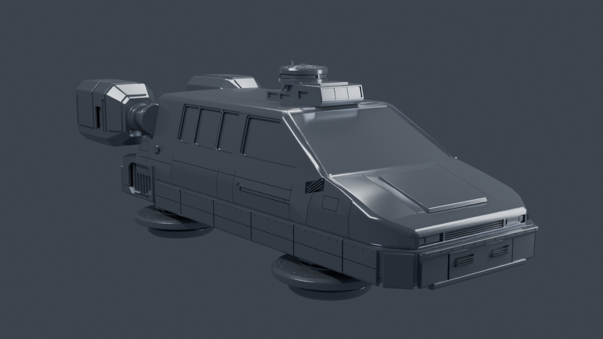 | 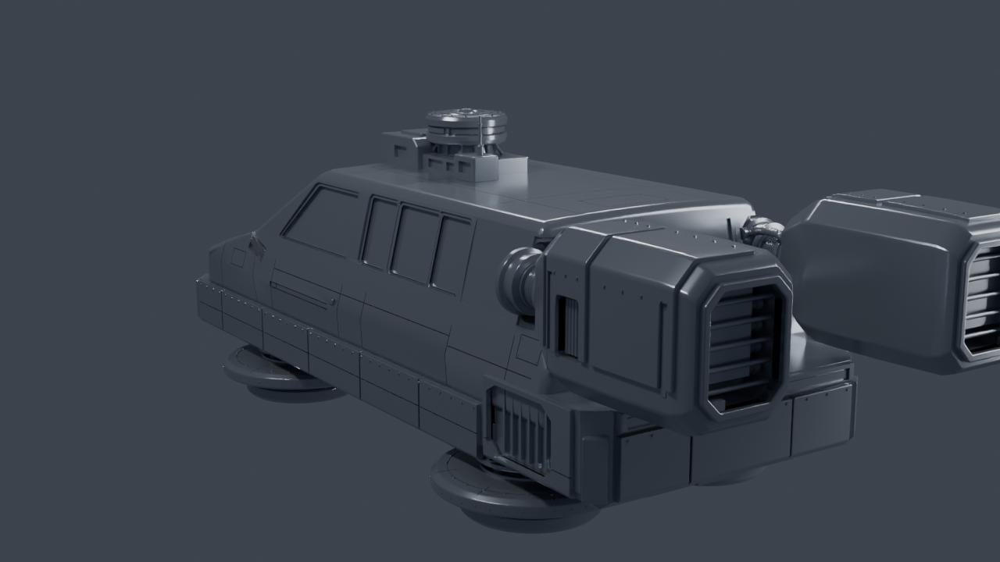 | 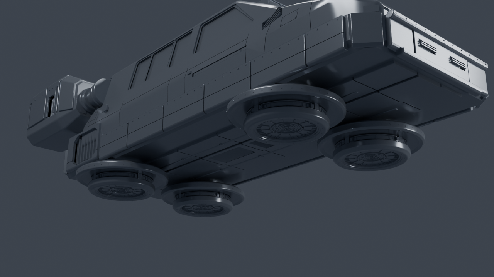 |
| Advanced study (2026-10-15) | 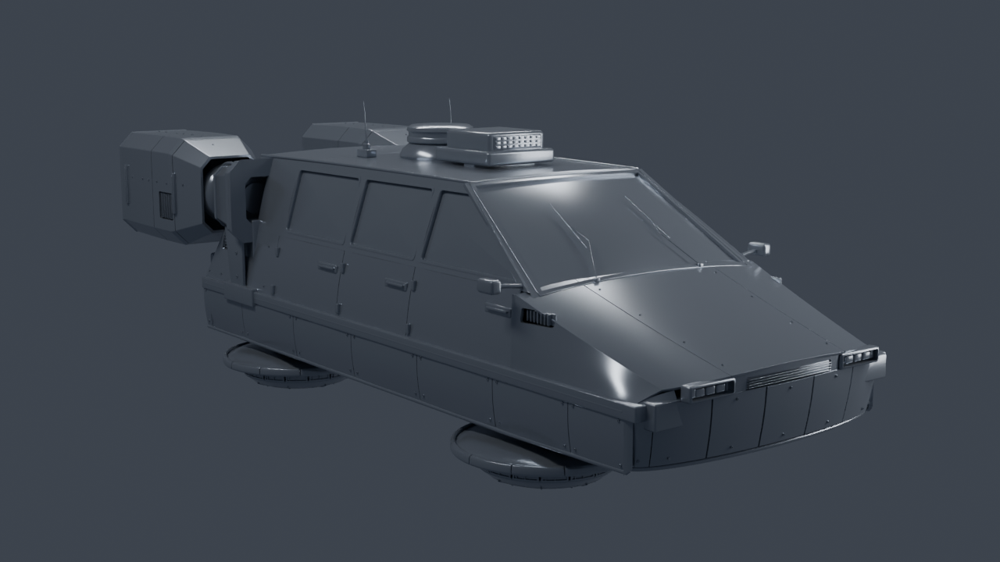 | 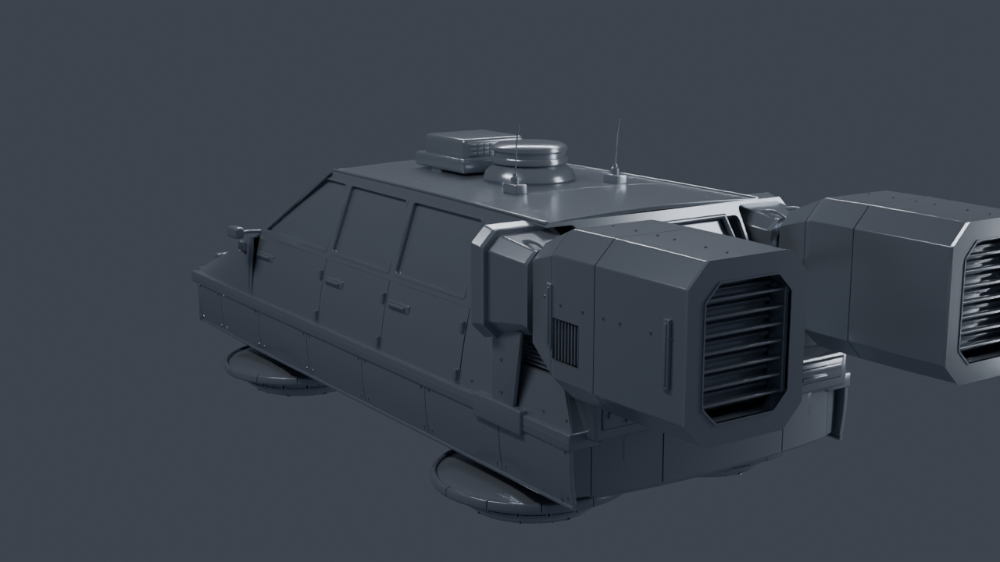 | 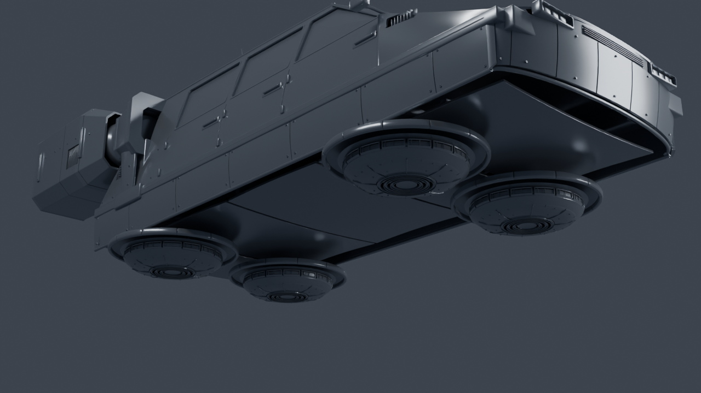 |
| Gated rebuild (2026-10-16) | 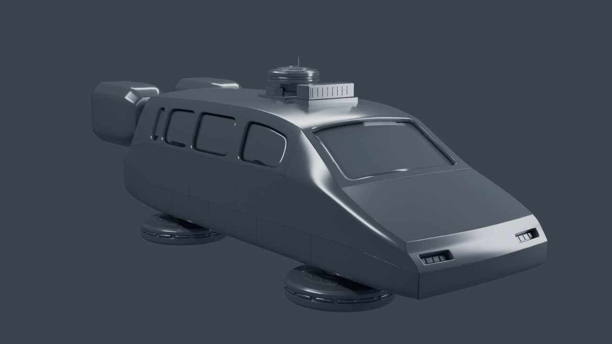 | 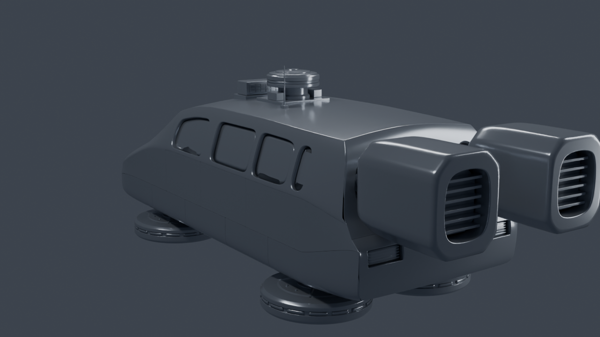 | 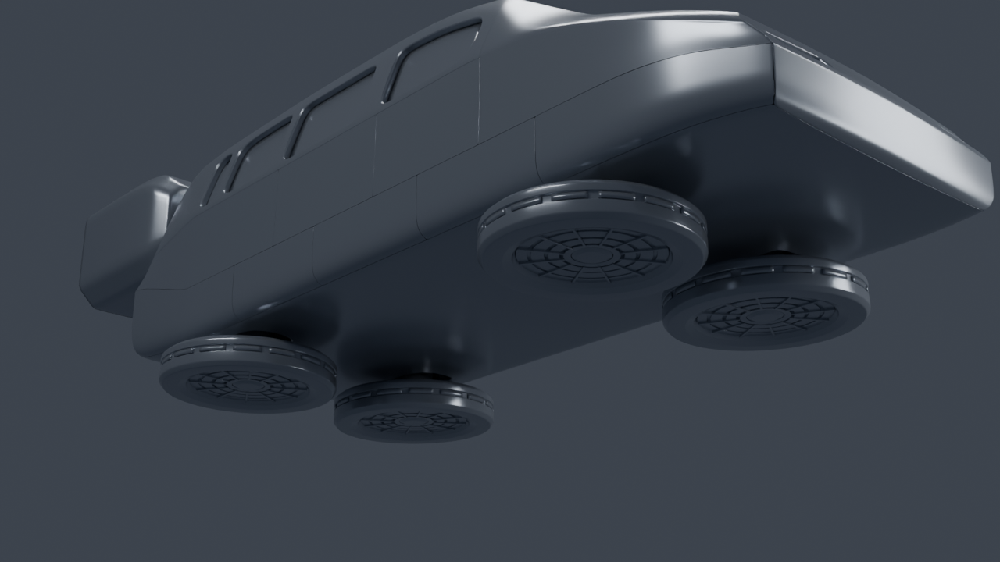 |

**What the gated build improves:**
- **Surfaces:** one continuous surface; zebra stripes run unbroken across doors, fenders, hood and roof.
- **Seams:** even 1.8-4.1 mm gaps that stay flush.
- **Openings:** lamps, glass, sockets and pad bays sit in recessed pockets with a flush rim, a filleted return and draft.
- **Attachment:** every mechanical part is bound to the ring of the pocket it fills, and that binding is measured.

The earlier builds had broken highlights, proud lamps and exposed mounts.

**Where the earlier builds are still ahead:** small exterior detail. The advanced study has a plated skirt, grilles, vents, wipers, mirrors and door handles. The gated build defers belly plating, grilles and vents, door and nacelle marker lights, and a stepped-out skirt. Each is listed in `decisions.json`.

## Detail close-ups

| Pad | Nacelle drive | Roof equipment |
|---|---|---|
| 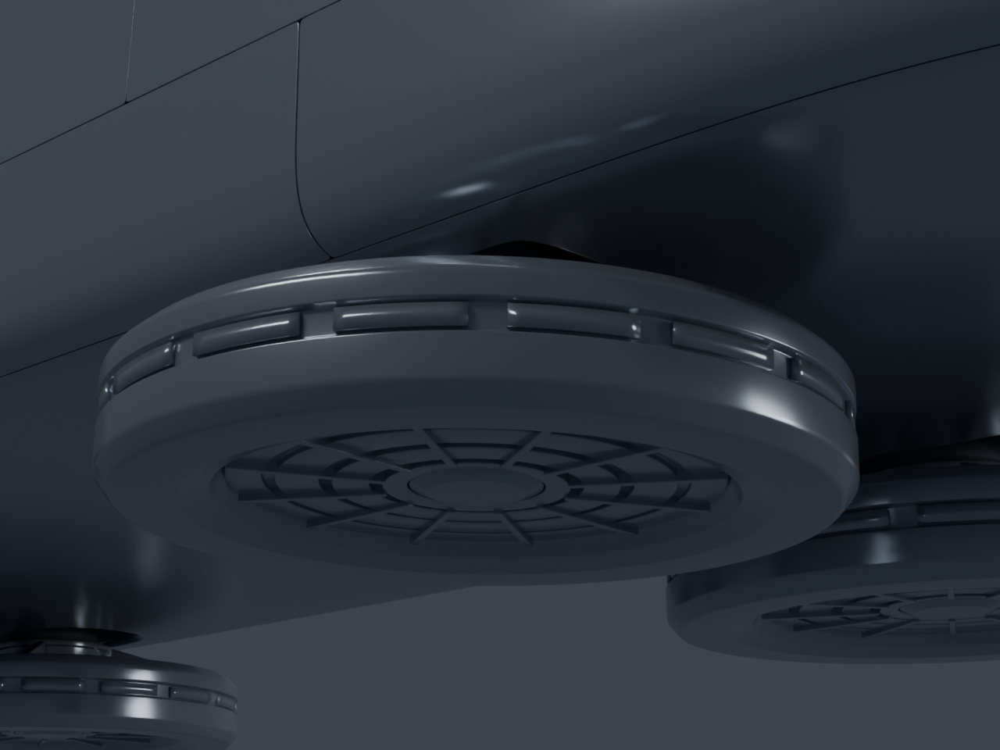 | 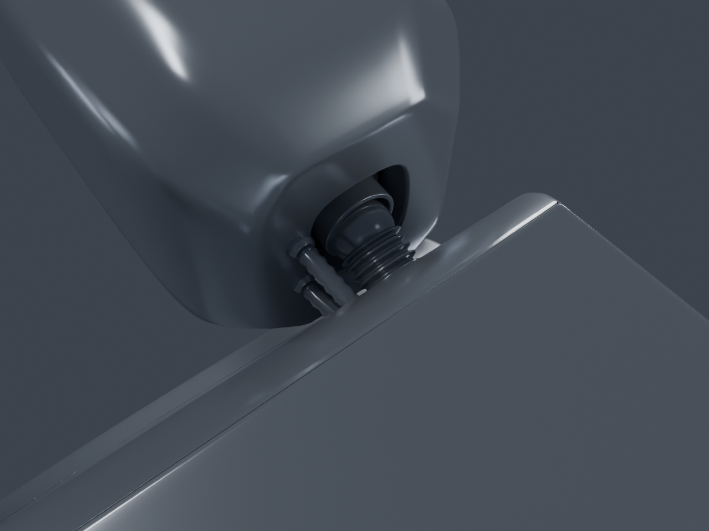 | 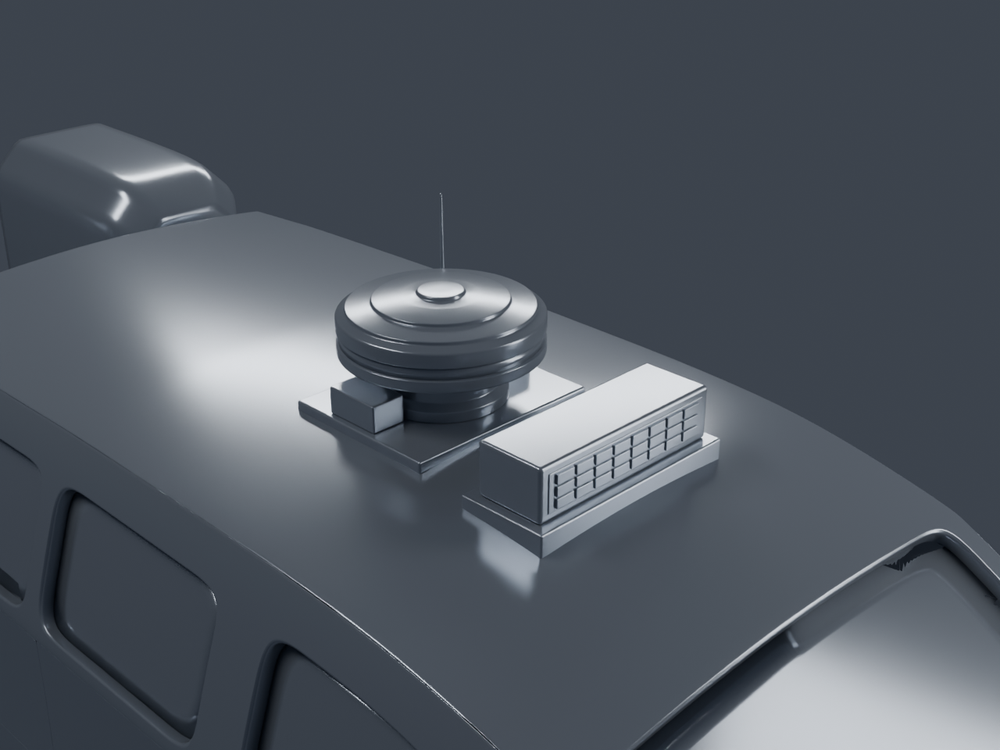 |

## Measured at acceptance

| Gate | Key measurements |
|---|---|
| 0 Calibration | primary camera 10.9 px RMS (limit 12 px, user decision) |
| 1 Master | closed (0 open edges); silhouette IoU 0.830 primary, 0.817 profile (limit 0.80, master only) |
| 2 Panels | seam gaps 1.8-4.1 mm, steps at most 0.009 mm, tangent break under 0.3 deg; no pocket vertex more than 0.104 mm proud; master coverage complete within 9 mm |
| 3 Detail | 10 mating joints exactly on axis and centre, 0 skin crossings: pad bosses 40 mm, drum flanges 15 mm, shafts 80 mm, couplings 10 mm; glass 40-45 mm behind the outer surface; silhouette IoU 0.837 primary, 0.887 profile (limit 0.83) |

Every threshold that differs from the toolkit default is a user decision, recorded with its reason in `project.toml` and `decisions.json`. The toolkit defaults are starting values from an unverified engineering report, not validated limits.

## Interpretations recorded with the user

- **Nacelle drive:** each shaft runs coaxial with its socket, which faces 18 deg up because the rear face leans back. It meets the forward-facing nacelle hub in a bellows-sealed angle joint.
- **Roof equipment:** seated on the roof surface. The roof panel has no mount opening, so the equipment has no typed attachment check.

## Working on it

Start with `geometryforge context .`. Parts and checks are declared in `project.toml`. Dimensions are in `parameters.json`. Decisions, amendments and threshold reasons are in `decisions.json`. Blind critiques for each gate are in `reviews/`. `acceptance/` holds the gate acceptance records: hashes, check measurements, review evidence, the critique and the quoted approval. In a fresh clone, run the gates again to rebuild the local safe points; review renders and run evidence are not committed.

The builder is split by gate: `models/master_cage.py` (Gate 1), `models/panels.py` (Gate 2) and `models/detail.py` (Gate 3). `models/blender.py` dispatches between them.
